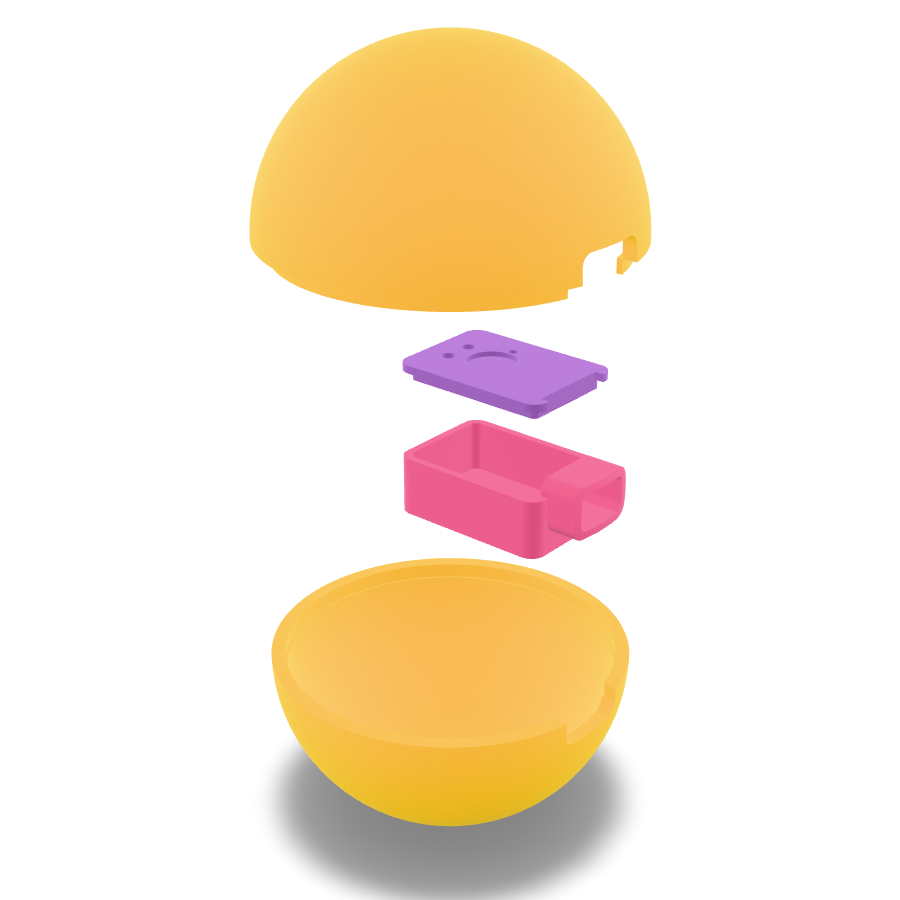

# Press-On v2 hardware

Wireless Press-On: the electronics live inside the ball, run on a small LiPo, and charge (and flash) through a USB-C outlet on the side.



## Parts

| Part | Notes |
| --- | --- |
| Seeed XIAO ESP32-C3 or ESP32-S3 | Both work with the same firmware and enclosure. Both need their **FPC antenna** attached (comes in the box). Stick it flat on the pod lid. |
| LiPo, single cell, about 30 x 20 x 4 mm | "402030" (around 200 mAh). A 5 mm "502030" also fits; set `LIPO_T = 5.0` in `enclosure.py`. Solder to the **BAT+ / BAT−** pads under the XIAO. The XIAO charges it over USB-C. |
| Flex sensor (the one from v1) | Same wiring as v1, but powered from 3V3 instead of 5V. |
| Fixed resistor for the sensor divider | Use the one from v1, or pick one close to the sensor's flat resistance (measure it). |
| Optional: 10 mm coin vibration motor (LRA or ERM) | For haptics. Sits in the round seat on the pod lid. |
| Optional: DRV2605L breakout, or a small N-MOSFET (AO3400, 2N7000) + 1N4148 diode | To drive the motor. The DRV2605L gives much nicer haptics. |
| Optional: 2 x 220 kΩ resistors | Battery level sensing. |
| Soft foam | Fills the space around the pod so it doesn't rattle and the squeeze feels even. |
| Filament | Shell: flexible (NinjaTek / TPU, like v1). Pod: PLA or PETG. |

## Wiring

```
  3V3 ──[ fixed R ]──┬── A0         flex sensor divider (same idea as v1)
                     │
                [ flex sensor ]
                     │
  GND ───────────────┘

  BAT+ pad ── LiPo red        BAT− pad ── LiPo black      (under the XIAO)

  Optional battery sense:  BAT+ ──[220k]── A1 ──[220k]── GND

  Optional haptics, pick one and set HAPTICS_MODE in firmware/PressOnBLE/config.h:
    DRV2605L:  VIN→3V3  GND→GND  SDA→D4  SCL→D5  motor on OUT+/OUT−      (HAPTICS_DRV2605)
    MOSFET:    D3 → gate,  motor between 3V3 and drain,  diode across the motor,  source → GND   (HAPTICS_PWM)
```

## Printing

```bash
pip install trimesh manifold3d numpy
python enclosure.py                 # 75 mm (v1 size)  -> stl_75mm/
python enclosure.py --diameter 85   # 85 mm            -> stl_85mm/
```

Both sizes are already generated in this folder.

- **Shell halves:** flexible filament, print each half with the open side down. The top half has a lip that slides into the bottom half; glue it with a flexible adhesive once everything works.
- **Pod tray and lid:** PLA or PETG, 0.2 mm layers, no supports needed for the tray if printed open side up.
- **Measure first.** Every size in the script (XIAO, LiPo, cable plug, clearances) is a variable at the top of `enclosure.py`. Change them to match your parts and re-run.

## The USB-C outlet

The pod has a sleeve that runs out to the surface of the ball, and the flexible shell wraps around it. Because the board has to sit inside the sphere, the USB-C port ends up about **9 mm below the surface**. The cable's plastic plug slides into the sleeve to reach it.

- Slim cables fit (the sleeve opening is 13 x 7.6 mm, `PLUG_W` / `PLUG_H`). Very chunky plugs won't.
- If you want the port flush with the surface instead, use a short USB-C extension (male to female panel mount) inside the pod. Widen `PLUG_W`/`PLUG_H` to the panel connector's size.

## Assembly

1. Flash the firmware with the XIAO on the bench first (see `firmware/`), and check the readings over USB.
2. Solder the LiPo, sensor wires, and optional motor and divider.
3. Battery in the bottom of the tray, a 1 mm foam pad on top, then the XIAO with its USB-C pushed up against the sleeve.
4. Feed the sensor (and motor) wires through the lid holes, press the lid on, stick the antenna on top.
5. Glue the flex sensor along the inside of the shell, about 5 mm under the surface like v1, on the side away from the pod.
6. Pack soft foam around the pod, close the two halves around the sleeve, and test before gluing.

## Power

- Charges whenever USB-C is plugged in.
- After 10 minutes with no app connected and no squeezing, the ball naps (deep sleep). **Squeeze it to wake it up.** Times are in `config.h`.
- There's no power switch, to keep the shell simple. If you want one, put a small slide switch in series with BAT+ and note that the battery only charges while it's on.
